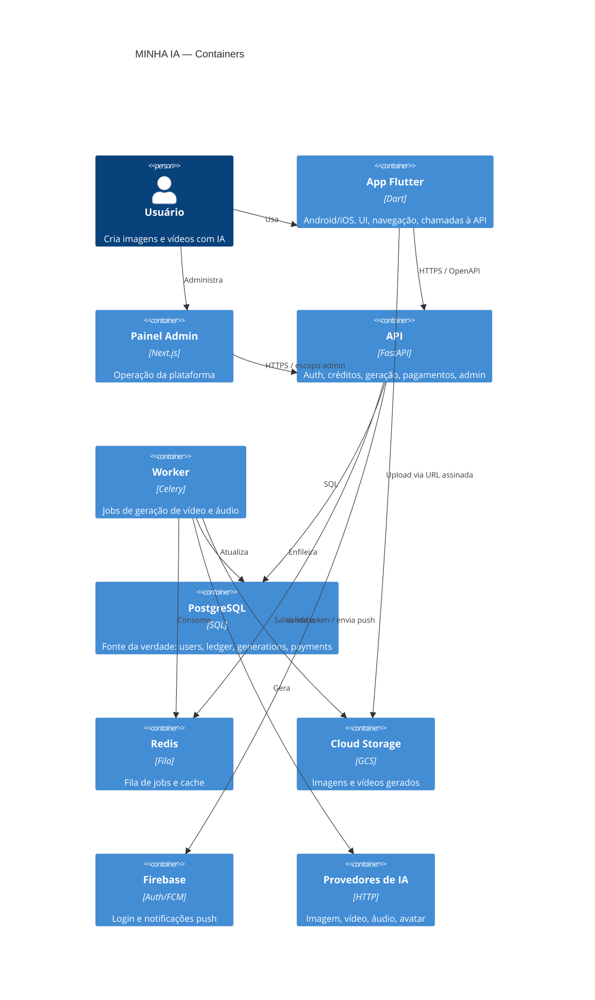
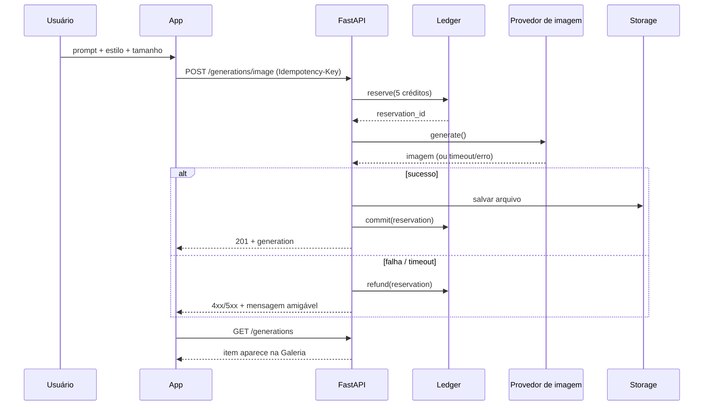
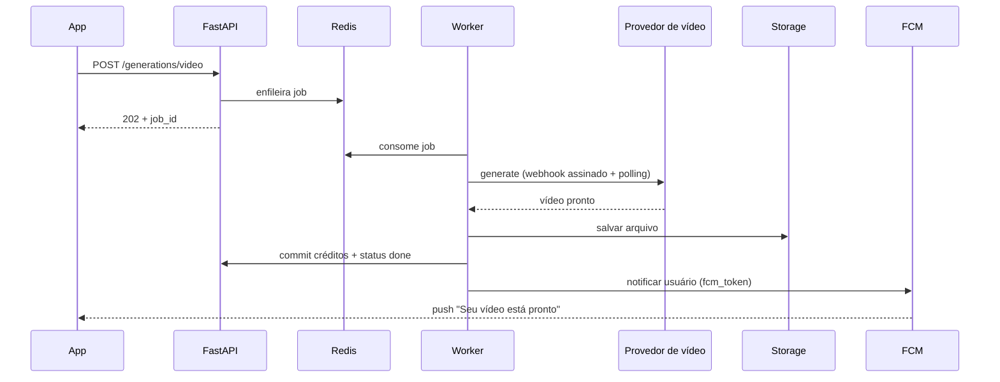

# MINHA IA — Arquitetura

> Versão 1.0 · 2026-11-17

## 1. Diagrama de containers (C4 nível 2)

## 2. Fluxo de geração de imagem (MVP-0)

## 3. Fluxo de geração de vídeo (MVP-1)

## 4. Modelo de dados (resumo)

| Tabela | Campos-chave | Observação |
|---|---|---|
| `users` | id, firebase_uid, email, plan_id, fcm_token, status, consent_version | criada na E1c |
| `plans` | id, nome, creditos_mensais, preço, recorrência | seed dos 4 planos |
| `credit_accounts` | user_id, balance | saldo disponível |
| `credit_ledger` | user_id, amount, reason, idempotency_key, balance_after | **append-only** |
| `generations` | user_id, type, provider, status, params, storage_path, cost_credits | histórico |
| `payments` | user_id, provider, external_id, amount, status | nunca apagado |
| `cost_config` | operação, custo_estimado, creditos, enabled | tabela mestre ADR 0003 |
| `webhook_events` | provider, event_id, payload | unique(provider,event_id) |
| `admin_audit_log` | admin_id, action, target, timestamp | imutável |

## 5. Regras de segurança

1. App → API com token Firebase; API valida no middleware.
2. App nunca recebe chaves de provedores de IA nem de pagamento.
3. Upload de mídia por URL assinada, com MIME/tamanho validados no backend.
4. Webhooks exigem assinatura válida + deduplicação.
5. Ledger e pagamentos são append-only; anonimização LGPD preserva valores.
6. Toda rota administrativa exige papel `admin`/`super_admin` e gera log.
